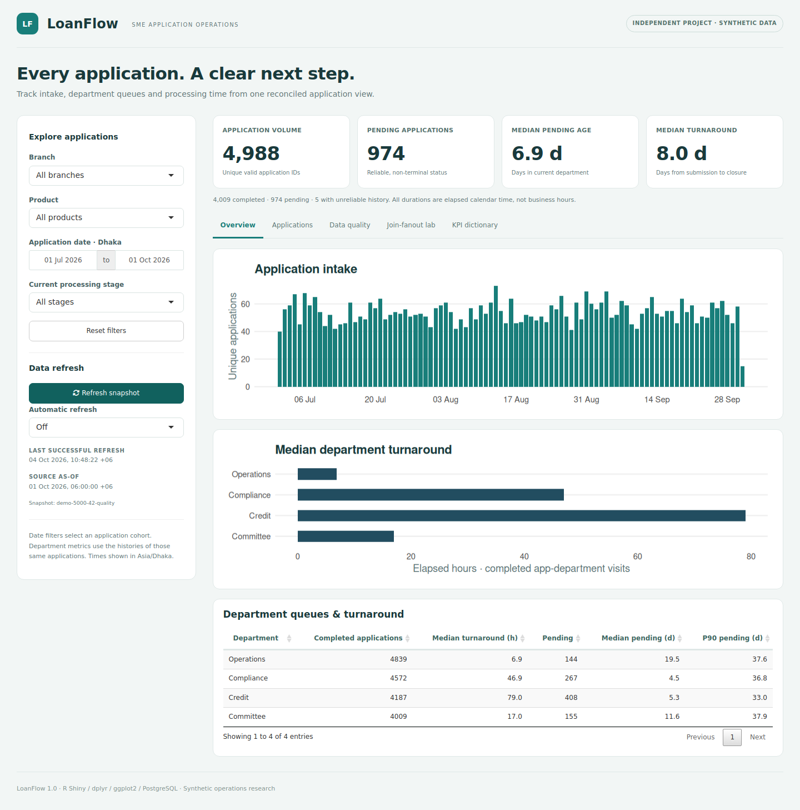

# LoanFlow · SME Application Dashboard

**Independent project · R Shiny · dplyr · ggplot2 · PostgreSQL**

A runnable application-operations dashboard with a synthetic dataset, reconciled application counts, department queues, turnaround metrics, data-quality diagnostics and failure-safe refreshes.



The included **18% join-fanout bug is a deliberately constructed regression fixture**: 1,000 applications join to 1,180 history rows; reducing history to the latest status restores 1,000 rows and 1,000 unique IDs. It is not a claimed production incident. The main dataset has full multi-stage histories and its own raw-versus-clean reconciliation.

## Run on your Mac

1. Extract `loanflow.zip` and open Terminal or Warp.
2. Install **R 4.3.3** from CRAN for your Mac architecture. Do not use `brew install r` for this locked environment: that installs a newer R release.
   - [Apple Silicon (M1/M2/M3/M4 and newer)](https://cran.r-project.org/bin/macosx/big-sur-arm64/base/R-4.3.3-arm64.pkg)
   - [Intel](https://cran.r-project.org/bin/macosx/big-sur-x86_64/base/R-4.3.3-x86_64.pkg)
3. Open the downloaded `.pkg` and complete installation. Keep your existing Homebrew R; the launcher selects R 4.3.3 explicitly.
4. Run from the extracted project folder:

```bash
cd ~/Downloads/loanflow
bash scripts/r.sh scripts/setup.R
bash scripts/r.sh run.R
```

Open **http://127.0.0.1:3838**. Stop with **Control+C**. The dashboard binds only to your own machine.

বাংলায়: R 4.3.3 install করুন। নতুন launcher নিজেই সঠিক R খুঁজে নেবে; Homebrew R uninstall করতে হবে না। প্রথম command dependencies install করবে, দ্বিতীয়টি dashboard চালাবে। CSV demo চালাতে PostgreSQL server লাগবে না।

The included lockfile and CI target **R 4.3.3**, not arbitrary newer R versions. Setup rejects incompatible runtimes before downloading packages. Dependencies are installed under `.Rlibrary/R-4.3.3-<platform>/`, separate from any earlier failed install. Internet is needed for setup; the bundled demo runs offline afterward.

**If your log contains `SETLENGTH`, `R_ext/PrtUtil.h`, `ATTRIB` or `Rf_findVarInFrame` errors under R 4.6, read [the recovery guide](docs/MAC_SETUP_FIX.md).** Re-running the old setup with that R version will not fix the mismatch.

If an archived dependency needs compilation, install Apple's command-line tools with `xcode-select --install`. If setup specifically reports missing `libpq` or `pg_config`:

```bash
brew install libpq pkg-config
export PATH="$(brew --prefix libpq)/bin:$PATH"
export PKG_CONFIG_PATH="$(brew --prefix libpq)/lib/pkgconfig:${PKG_CONFIG_PATH:-}"
bash scripts/r.sh scripts/setup.R
```

RStudio must also use R 4.3.3. Open this folder as the working directory, run `source("scripts/setup.R")` once, then `shiny::runApp(".")`. Alternatively use the terminal launcher above regardless of which R RStudio selects.

## What the dashboard contains

| Area | Features |
|---|---|
| Filters | Branch, product, inclusive application-date range, current processing stage |
| KPI cards | Unique application volume, pending count, median current-department pending age, median submission-to-closure turnaround |
| Overview | Daily intake plot, median department turnaround plot, department queue table with median/p90 pending ages |
| Applications | One row per application, searchable table, export of the current filter cohort |
| Data quality | Missing fields, exact/conflicting duplicates, malformed/future/reversed timestamps, orphan records and invalid status sequences |
| Fanout lab | Executable 18% bug demonstration and corrected join |
| Dictionary | Definitions, denominators, time units and refresh semantics |
| Refresh | Manual refresh, optional 1-/5-minute refresh, retained previous data after failure |

The source observation cutoff and the session's last successful refresh time are different and displayed separately. The bundled source is frozen at **2026-10-01 00:00 UTC / 06:00 Asia/Dhaka**. Pressing Refresh does not invent newer source data.

## PostgreSQL setup

Install and open [Docker Desktop for Mac](https://docs.docker.com/desktop/setup/install/mac-install/) if you want the included database service.

```bash
docker compose up -d --wait
cp .Renviron.example .Renviron
bash scripts/r.sh scripts/db_upload.R
```

Change the first line of `.Renviron` to:

```text
LOANFLOW_SOURCE=postgres
```

Restart `bash scripts/r.sh run.R`. The dashboard now reads the same raw data from PostgreSQL. The CSV and PostgreSQL modes share all cleaning and KPI code.

| Database setting | Default local value |
|---|---|
| Host | `127.0.0.1` |
| Port | `5434` |
| Database | `loanflow` |
| User | `loanflow` |
| Password | `local_demo_only` |
| Schema | `loanflow` |

Use those values in Beekeeper Studio. The database is localhost-only. If you change `LOANFLOW_DB_PASSWORD` for Docker Compose, also change `PGPASSWORD` in `.Renviron`. `.Renviron` is excluded from Git.

Uploads are transactional and idempotent. Repeating the same snapshot does not duplicate rows. Reusing a snapshot ID with different data is rejected; use a new snapshot ID. Raw landing tables preserve bad records for audit. Clean application views are computed in R, not silently written over raw data. Refresh reads metadata and both raw tables in a repeatable-read transaction.

With `LOANFLOW_SNAPSHOT_ID` blank, PostgreSQL mode chooses the snapshot with the latest source `as_of`, then latest upload time. Set an exact ID to pin a snapshot. Uploading older data does not make it the newest source. `docker compose stop` retains database data.

For an existing PostgreSQL service, fill the `PG*` variables in `.Renviron`. RPostgres requires separate host, database, user and password fields here; do not paste a full URL into `PGDATABASE`. Use the SSL setting required by your provider.

## Tests and reproducible reports

```bash
# Unit tests + Shiny server tests; the live database test is skipped by default.
bash scripts/r.sh tests/testthat.R

# With the local PostgreSQL service running:
LOANFLOW_TEST_POSTGRES=1 bash scripts/r.sh tests/testthat.R

# Save fresh report tables and ggplot figures to a new folder:
bash scripts/r.sh scripts/build_report.R outputs/my-report

# Generate another identical demo without overwriting the bundled data:
bash scripts/r.sh scripts/generate_demo.R data/my-demo
```

Scripts are run from the project root. Test commands read `.Renviron` automatically on R startup. The generator and report commands refuse to overwrite nonempty output directories.

The package includes `examples/reference/REPORT.md`, measured KPI tables, the complete quality log, plots, session information and output hashes. The main synthetic dataset uses seed 42 and contains 5,000 logical applications, with additional duplicate raw rows deliberately injected.

## Counting and timing rules

- **Application grain:** one valid application ID. Exact duplicate rows collapse; conflicting duplicates are quarantined.
- **Current status:** one latest valid event per application after full-timeline validation. The join enforces `relationship = "one-to-one"`.
- **Pending age:** source cutoff minus current stage entry, in elapsed days. Total time since submission is a separate exported field.
- **Department turnaround:** sum all completed visit durations per application/department first, then take the median across those application/department totals. Any pair with an open visit is excluded from this completed metric.
- **Overall turnaround:** terminal stage entry minus submission; includes Approved, Rejected and Withdrawn applications, not just approvals.
- **Invalid history:** keep valid application records in volume as `Data issue`; exclude them from queue and duration KPIs. Never infer a misleading current stage by dropping only the corrupted event.
- **Date filters:** application submission dates in Asia/Dhaka, inclusive at both ends. Other filters apply to the same application cohort; department charts use that cohort's histories.
- **Quality checks:** whole-snapshot scope, independent of filters. Several issues can refer to one row, so summed issues are not a count of removed records.

All times are calendar time, not working hours or SLA attainment. No business-calendar or holiday assumptions are hidden in the calculations. The full definitions are in [docs/DATA_DICTIONARY.md](docs/DATA_DICTIONARY.md).

## Project structure

```text
loanflow/
  app.R, run.R           # Shiny entrypoints
  R/                    # generator, quality checks, metrics, sources, UI/server, plots
  www/style.css         # responsive dashboard design
  data/demo/            # synthetic raw applications, histories, source metadata
  sql/                  # PostgreSQL schema, inspection queries, executable fanout demo
  scripts/              # setup, regeneration, database upload, report generation
  tests/testthat/       # grain, DQ, timing, filters, refresh and PostgreSQL tests
  examples/reference/   # executed demo reports and figures
  docs/                 # dictionary, architecture, verification and interview guide
  renv.lock             # captured R package versions
  compose.yaml          # local PostgreSQL
  .github/workflows/ci.yml
```

## Scope

This is a local educational application with synthetic data. It has no login system, access roles, audit-log retention service or production deployment. It is not suitable for exposing real applicant data unchanged. No credit decisioning, loan profitability or production incident experience is claimed. Follow the interview guide only after running and understanding the code.

## References

- [dplyr join cardinality and relationships](https://dplyr.tidyverse.org/reference/mutate-joins.html)
- [Shiny server testing](https://shiny.posit.co/r/articles/improve/server-function-testing)
- [RPostgres connections and timezone settings](https://rpostgres.r-dbi.org/reference/Postgres.html)
- [renv dependency snapshots and restoration](https://rstudio.github.io/renv/articles/renv.html)

MIT licensed; see `LICENSE`.
